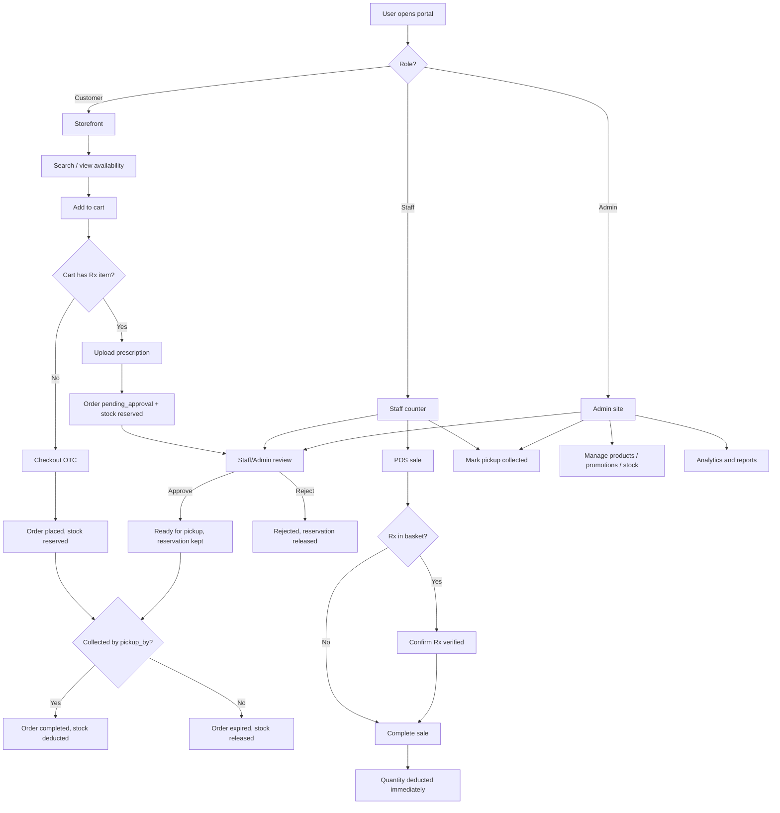
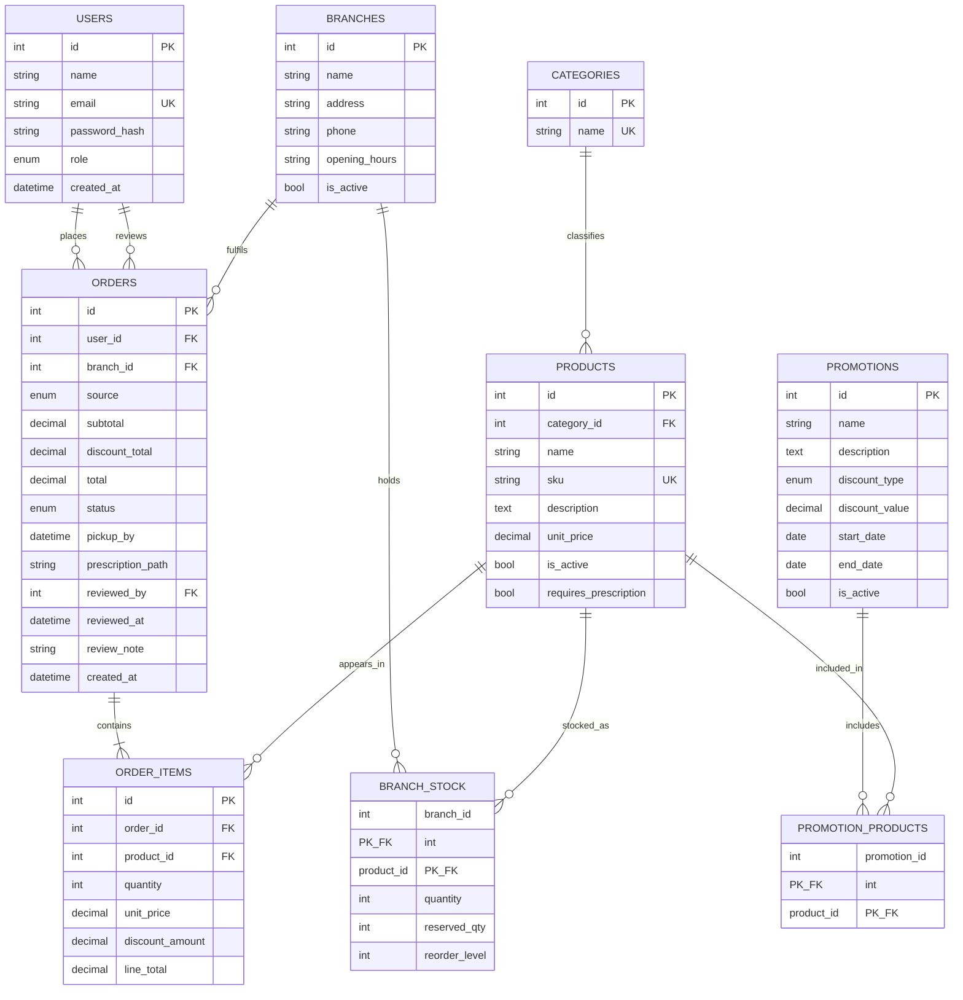
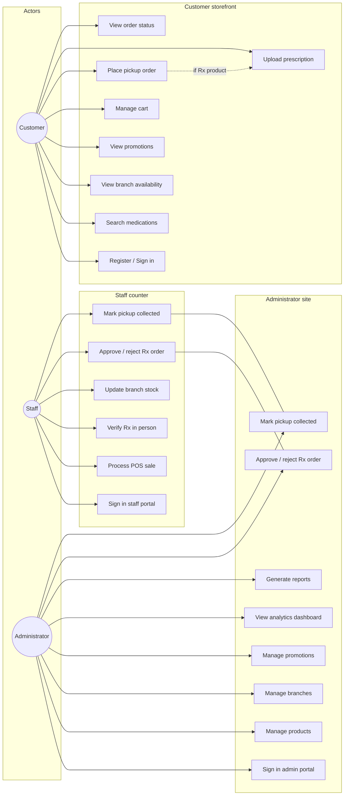

# Chapter 3 — System Analysis and Design

> Copy this chapter into your group report (Word/PDF). Replace the brand name if needed.  
> Render the Mermaid diagrams with [mermaid.live](https://mermaid.live), draw.io, or Lucidchart for the final PDF.  
> If GenAI assisted drafting of this chapter, acknowledge that in your report (AMBER GenAI policy).

---

## 3.1 System Overview

**OverDose Pharmacy** is a web-based pharmacy management system developed for the healthcare sector as part of the 5027CMD Web Development module. The system supports multi-branch medication inventory, customer self-service browsing and online pickup orders, in-store point-of-sale (POS), promotional discounts, prescription (Rx) verification, stock reservation for uncollected pickups, and administrative analytics.

The application is implemented as a **dynamic, data-driven website** using:

| Layer | Technology |
| --- | --- |
| Presentation | HTML5, CSS3, JavaScript |
| Server-side | PHP (server-side scripting and page templating) |
| Database | MySQL / MariaDB (via XAMPP) |
| Web server | Apache (XAMPP), with `.htaccess` rewrite rules for JSON APIs |
| Charts | Chart.js (admin dashboard visualisations) |

Architecturally, the system is organised as **three role-separated portals** that share one MySQL database (`pharmacy`):

1. **Customer storefront** — browse, search, view branch availability, cart, checkout  
2. **Staff counter** — in-store POS, stock updates, prescription approvals, pickup collection  
3. **Administrator site** — catalogue, branches, promotions, reports, analytics, Rx approvals  

This separation strengthens authorisation: a customer account cannot sign in to the staff or admin portals, and staff/admin sessions are redirected away from the customer shop.

Medication **stock is stored per branch** (`branch_stock`), not as a single global quantity. Each stock row tracks **on-hand quantity** and **reserved quantity**. What customers see as available is:

**Available = quantity − reserved_qty**

When a customer places an online pickup order, the system **reserves** stock at the chosen branch (increases `reserved_qty`) and sets a **pickup deadline** (`pickup_by`, 48 hours). Quantity is only permanently reduced when staff mark the order as collected. If the customer does not collect by the deadline, the order is **expired** and the reservation is released.

Selected products require a prescription upload; those orders stay **pending approval** (with stock already reserved) until staff or an administrator approve or reject them.

---

## 3.2 System Features

The implemented features map to the three project objectives: pharmacy management, multi-branch availability and promotions, and analytics/reporting.

### 3.2.1 Pharmacy management
- Maintain medication/product records (name, SKU, category, price, description, active status, Rx flag)
- Maintain pharmacy **branches** (address, phone, hours, active flag)
- Maintain **branch stock** with on-hand quantity, reserved quantity, and reorder levels
- Record **online pickup** (reservation) and **in-store POS** (immediate deduction) sales
- Apply promotions automatically at checkout and POS

### 3.2.2 Multi-branch availability and promotions
- Search medications by name, SKU or description
- Display **available** stock across branches (excluding reserved holds)
- Create and manage promotions (name, description, percent/fixed discount, dates, status, linked products)
- Show active promotions on the customer site

### 3.2.3 Reservation and pickup deadline
- Online checkout increases `reserved_qty` (does not reduce `quantity` yet)
- Orders store `pickup_by` (48-hour collection window)
- Staff mark collection → convert reservation into a quantity deduction
- Overdue orders auto-expire and release reserved stock

### 3.2.4 Prescription control (healthcare-specific)
- Customer uploads a prescription file (PDF/JPG/PNG) when the cart contains Rx items
- Order statuses: `pending_approval` → `ready_for_pickup` / `rejected` / `expired` / `completed`
- Staff/admin review queue with secure file viewing
- POS requires an on-site “prescription verified” confirmation for Rx items
- Reservation is created at checkout; approval keeps the hold; rejection releases it

### 3.2.5 Analytics and reporting
- Admin dashboard cards and Chart.js visualisations from MySQL data
- Best-selling medications and low-stock tables (based on **available** stock)
- Reports (HTML + CSV): sales, bestsellers, inventory (on hand / reserved / available), low stock, branch performance

### 3.2.6 Security and API support
- Role-based authentication (bcrypt password hashes)
- Session security (HttpOnly cookie, CSRF tokens on POST forms)
- Prepared statements for database queries
- JSON APIs: `GET /api/products`, `GET /api/products/{id}/availability`

---

## 3.3 User Roles

| Role | Portal | Main responsibilities |
| --- | --- | --- |
| **Customer** | Storefront (`/pharmacy/`) | Register/sign in; browse and search products; view branch availability; view promotions; place online pickup orders; upload prescription when required; view own order status and pickup deadline |
| **Staff** | Staff site (`/pharmacy/staff/`) | Sign in to counter; run in-store POS; update branch stock; review and approve/reject prescription orders; mark pickups as collected |
| **Administrator** | Admin site (`/pharmacy/admin/`) | Manage products, branches, stock and promotions; view analytics dashboard; generate reports; review prescription approvals; complete pickups |

**Authorisation rules**
- Each portal’s login accepts **only** the matching role.
- Customers cannot access staff/admin pages.
- Staff cannot access the admin catalogue/reports site (except shared Rx approval and pickup tools where permitted).
- Admins and staff opening the customer storefront are redirected to their own portal.

---

## 3.4 Functional Requirements

The following functional requirements (FRs) describe what the system shall do.

| ID | Requirement | Priority |
| --- | --- | --- |
| FR-01 | The system shall allow customers to search and browse medications. | Must |
| FR-02 | The system shall display medication availability per pharmacy branch as Available / Out of stock, using available stock (quantity − reserved_qty). | Must |
| FR-03 | The system shall allow customers to add products to a cart and place an online pickup order at a chosen branch. | Must |
| FR-04 | The system shall apply stock changes only at the selected branch for each sale or reservation. | Must |
| FR-04a | The system shall increase `reserved_qty` (not `quantity`) when a pickup order is placed, and only convert reserved stock to a deduction from `quantity` when the order is completed at pickup. | Must |
| FR-04b | The system shall automatically expire orders not collected by their `pickup_by` deadline and release the reserved stock back to available stock. | Must |
| FR-05 | The system shall allow administrators to create, update and deactivate products and branches. | Must |
| FR-06 | The system shall allow administrators and staff to update stock quantities and reorder levels per branch. | Must |
| FR-07 | The system shall allow administrators to create promotions with discount type, value, date range, status and linked products. | Must |
| FR-08 | The system shall apply the best active promotion to eligible products at checkout and POS. | Must |
| FR-09 | The system shall require a prescription upload for products marked `requires_prescription` during online checkout. | Must |
| FR-10 | The system shall hold Rx online orders in `pending_approval` until staff/admin approve or reject them. | Must |
| FR-11 | The system shall allow staff to record walk-in sales via POS and confirm in-person Rx verification when needed. | Must |
| FR-12 | The system shall provide an admin analytics dashboard based on stored order and stock data. | Must |
| FR-13 | The system shall generate sales, bestseller, inventory, low-stock and branch performance reports (including CSV export). | Must |
| FR-14 | The system shall authenticate users and enforce role-based access to each portal. | Must |
| FR-15 | The system shall expose JSON endpoints for product search and branch availability. | Should |

---

## 3.5 Non-Functional Requirements

| ID | Category | Requirement |
| --- | --- | --- |
| NFR-01 | Usability | The UI shall provide clear navigation, consistent layout and readable typography across customer, staff and admin portals. |
| NFR-02 | Responsiveness | Layouts shall adapt to common desktop and mobile screen sizes (responsive CSS). |
| NFR-03 | Security | Passwords shall be stored using bcrypt; sessions shall use HttpOnly cookies; POST forms shall include CSRF tokens; SQL shall use prepared statements. |
| NFR-04 | Security | Prescription files shall not be publicly listable; access shall be mediated by an authenticated download script. |
| NFR-05 | Performance | Product search and availability queries shall use indexed columns (e.g. product name, order dates, stock keys). |
| NFR-06 | Reliability | Stock updates, reservations, and order creation shall run inside database transactions (commit/rollback). |
| NFR-07 | Maintainability | Server logic shall be modularised (`includes/` helpers for auth, catalog, sales, reports). |
| NFR-08 | Compatibility | The system shall be deployed to a live PHP-capable hosting environment (e.g. a LAMP-stack VPS or shared PHP/MySQL host) and remain accessible for the assessment demonstration. |
| NFR-09 | Integrity | Analytics and reports shall be derived from real database records, not fabricated figures. |
| NFR-10 | Data design | The relational schema shall be normalised to at least Third Normal Form (3NF). |

---

## 3.6 System Flow / Use Case Diagram

### 3.6.1 High-level system flow

**Figure 3.1** — High-level process flow including reservation, Rx approval, collection and expiry.

### 3.6.2 Online order sequence (summary)

1. Customer checks out at a chosen branch.  
2. System checks **available** stock (`quantity − reserved_qty`), increases `reserved_qty`, and sets `pickup_by` (48 hours).  
3. OTC orders become `ready_for_pickup`. Rx orders become `pending_approval` (reservation already held).  
4. On Rx approve → `ready_for_pickup`. On reject → reservation released.  
5. Staff mark collected → `quantity` and `reserved_qty` both reduced; status `completed`.  
6. If `pickup_by` passes first → status `expired` and reservation released.

---

## 3.7 Entity Relationship Diagram (ERD)

The database contains nine main entities. Stock is modelled as an associative entity between **branches** and **products**, with both on-hand and reserved quantities. Promotions link to products through **promotion_products**. Orders link to users (nullable for walk-in POS), branches, and line items, and store pickup deadline and workflow status.

### 3.7.1 ERD (logical)

**Figure 3.2** — Entity Relationship Diagram (including `reserved_qty` and `pickup_by`).

**Order status values:** `pending_approval`, `approved`, `rejected`, `ready_for_pickup`, `completed`, `expired`.

### 3.7.2 Normalisation note (3NF)

- **1NF:** Atomic attributes; no repeating groups (order lines stored in `order_items`).  
- **2NF:** No partial dependency on composite keys. In `branch_stock`, `quantity`, `reserved_qty` and `reorder_level` each depend on the full composite key `(branch_id, product_id)` — reserved stock is a property of that branch–product pair, not of either key part alone.  
- **3NF:** Non-key attributes depend on the primary key only (e.g. category name lives in `categories`, not duplicated on every product row beyond `category_id`).

---

## 3.8 Use Case Diagram

### 3.8.1 Combined use case diagram

**Figure 3.3** — Use case diagram showing actors and major use cases.

### 3.8.2 Use case summary table

| Use case | Actor(s) | Brief description |
| --- | --- | --- |
| Search medications | Customer | Search catalogue by keyword/category |
| View branch availability | Customer | See available stock per branch (excludes reserved) |
| Place pickup order | Customer | Choose branch; reserve stock; set pickup deadline |
| Upload prescription | Customer | Attach Rx file for prescription medicines |
| Process POS sale | Staff | Record walk-in sale and deduct quantity immediately |
| Approve / reject Rx order | Staff, Admin | Review uploaded Rx; keep or release reservation |
| Mark pickup collected | Staff, Admin | Convert reserved stock into quantity deduction |
| Manage products / promotions | Admin | CRUD on catalogue and campaign rules |
| View analytics / reports | Admin | Dashboard charts and CSV/HTML reports |

---

## How to use these diagrams in Word

1. Open [https://mermaid.live](https://mermaid.live).  
2. Paste each Mermaid block.  
3. Export as **PNG** or **SVG**.  
4. Insert into the report as Figure 3.1, 3.2, 3.3 with captions.  

Alternatively redraw in **draw.io** / **Lucidchart** using the same entities and relationships for a cleaner academic look.
